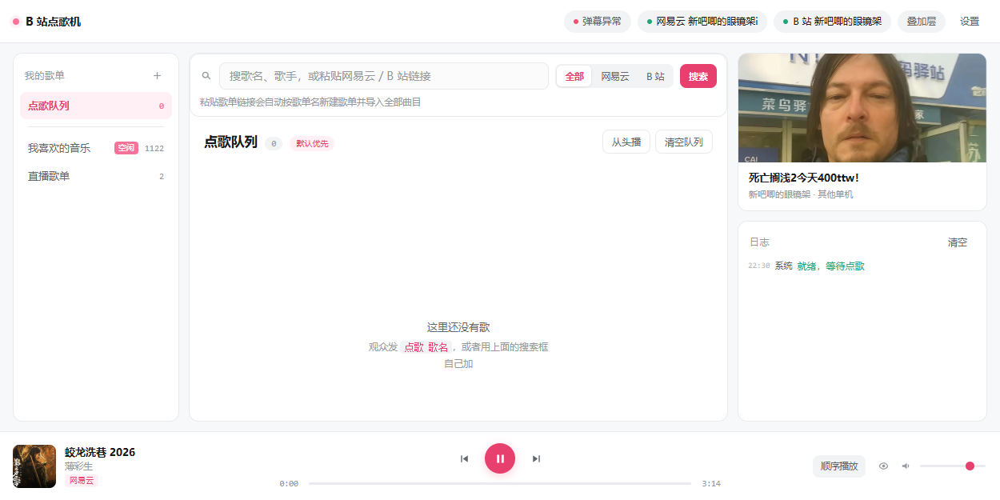
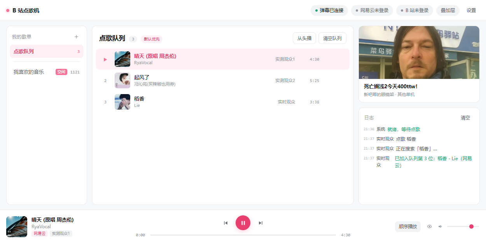
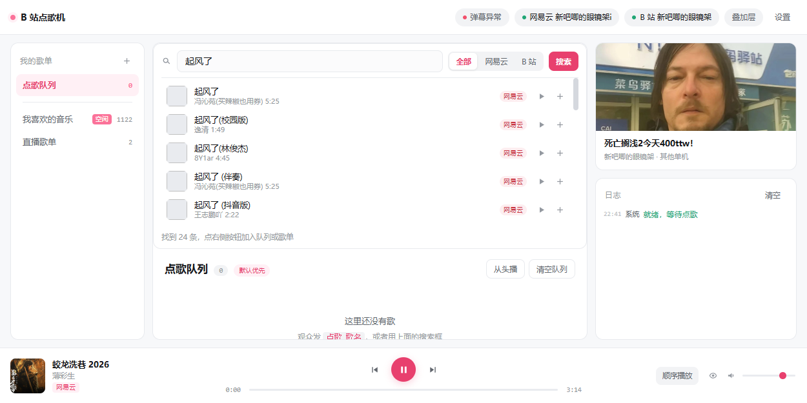
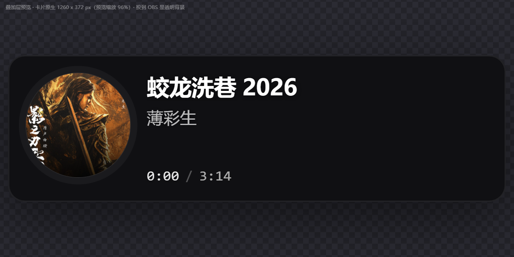
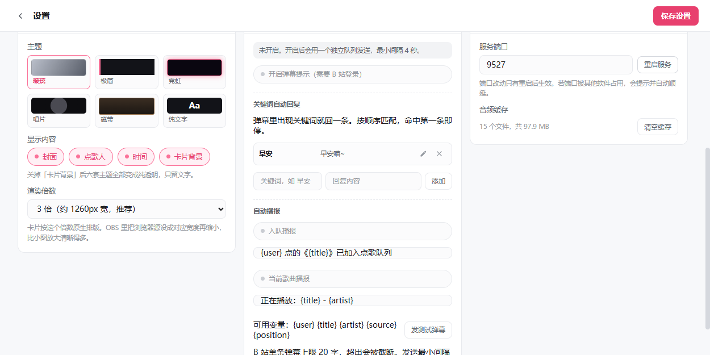
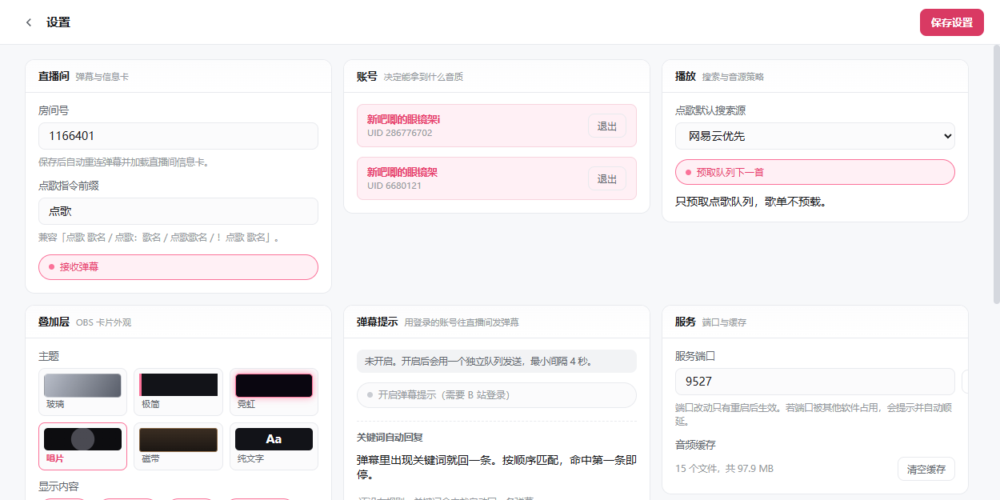

# 🐋 BiliLiveSongDrop

**B 站直播间弹幕点歌机**

观众发一句弹幕就能点歌 · 主播端自动排队播放 · OBS 透明信息卡

[下载最新版](https://github.com/xinbaji/BiliLiveSongDrop/releases/latest) · [功能一览](#功能) · [OBS 配置](#obs-配置) · [常见问题](#常见问题)

---

## 这是什么

一个装在主播电脑上的点歌台。观众在直播间发 `点歌 晴天`，歌就自动进入队列，按顺序播放；没人点歌时自动播放你预设的空闲歌单。同时提供一个**透明背景的信息卡**叠进 OBS 画面，观众能实时看到正在播什么、还剩多久。

点歌来源覆盖 **网易云音乐** 和 **B 站视频**：网易云搜不到或没有版权时，自动到 B 站找同名视频换源播放，直播间不会突然安静下来。

## 功能

### 🎵 点歌与队列

- 弹幕 `点歌 歌名` 即可入队，兼容全角符号、空格、冒号等十几种写法
- **正在播的那首始终显示在队列顶部**（带 ▶ 标记），播完才出队
- 队列播完自动切回预设的空闲歌单，直播间不留空档
- 同一首歌在队列里去重，观众不会把队列刷满

### 🔍 双源搜索

- 主界面顶部独立搜索卡，一次搜网易云 + B 站两个源
- 结果直接显示音源归属，一键加入队列或歌单
- 粘贴网易云歌单 / B 站收藏夹链接，自动以歌单名新建歌单并导入全部曲目
- 远程导入的歌单支持**一键刷新**：按远端列表做差异更新，手动收藏的歌不受影响

### 📺 OBS 透明信息卡

- 6 套主题：玻璃、极简、霓虹、唱片、磁带、纯文字，改完即时生效，OBS 不用刷新
- 卡片按 **2~4 倍原生渲染**（默认 3 倍，约 1260px 宽），OBS 里随便缩小都不糊
- 所有主题都能关掉背景，只留文字和封面
- 显示内容自由开关：封面 / 点歌人 / 时间

关掉卡片背景后的效果——棋盘格部分投到 OBS 就是完全透明的

### 💬 弹幕提示（可选）

用登录的 B 站账号往直播间发弹幕，默认关闭，需要手动开启：

- **关键词自动回复**：弹幕里出现「早安」就回一条，规则可添加、编辑、删除
- **入队播报**：`xxx 点的《晴天》已加入点歌队列`
- **当前歌曲播报**：`正在播放：晴天 - 周杰伦`

发送走独立串行队列，最小间隔 4 秒，失败指数退避，不会把自己号刷进小黑屋。

### ⚙️ 分类设置页

直播间、账号、播放、叠加层、弹幕提示、服务、关于——每一类都是独立卡片，改完统一保存。

### 🔄 在线更新

设置 → 关于 → 检查更新，直接从 GitHub Release 拉最新安装包，下载完自动覆盖重启，不需要手动重装。

## 快速开始

1. 到 [Releases](https://github.com/xinbaji/BiliLiveSongDrop/releases/latest) 下载 `BiliLiveSongDrop-windows-x64.zip`
2. 解压到任意目录，运行 `BiliLiveSongDrop.exe`
3. 设置 → 账号里扫码登录网易云（决定音质和点歌成功率），B 站登录可选
4. 设置 → 直播间里填你的房间号
5. OBS 添加浏览器源，地址填 `http://127.0.0.1:9527/overlay`，宽 `1300` 高 `420`

> 需要 WebView2 运行时。Windows 11 自带，Windows 10 缺失时微软会提示安装。

## OBS 配置

| 项目 | 建议值 | 说明 |
|---|---|---|
| 地址 | `http://127.0.0.1:9527/overlay` | 主界面的「叠加层」按钮可以直接复制 |
| 宽度 | `1300` | 卡片按 3 倍渲染是 1260px，留一点余量 |
| 高度 | `420` | 卡片高约 372px |
| 自定义 CSS | 不需要 | 背景本来就是透明的 |

信息卡在画面中的位置和大小直接用 OBS 的变换调整即可，因为是高倍渲染，缩得很小字照样清晰。

想只显示标题不挡画面，把主题切到「纯文字」，或者关掉「卡片背景」。

## 弹幕指令

| 指令 | 说明 |
|---|---|
| `点歌 晴天` | 点歌，加入队列 |
| `！点歌 晴天` / `点歌：晴天` / `点歌晴天` | 全部识别 |
| `取消点歌` | 撤回自己点过的歌 |
| `查队列` | 查看当前队列（主播端日志显示） |

前缀可以改，也支持别名。哪些人能用哪些指令（所有人 / 舰长 / 房管 / 仅主播）在配置里逐条控制。

## 数据与隐私

所有用户数据——登录 cookie、歌单数据库、音频缓存——**全部保存在本机** `%LOCALAPPDATA%\BiliLiveSongDrop\`：

- Cookie 用 Windows DPAPI 按用户加密后落库，换机器解不开，不会明文留盘
- 程序不上传任何个人信息，唯一的外部请求是点歌时的音源接口和 GitHub 更新检查
- 项目仓库里没有任何账号数据，重新克隆一份源码不含你的登录态

音频缓存默认上限 2GB，超出自动 LRU 淘汰，设置里可以一键清空。

## 常见问题

<b>点了歌没反应？</b>

先看主界面顶部「弹幕」胶囊是不是绿色「已连接」。灰色就进设置填房间号。另外点歌需要歌能被搜到——如果网易云没有版权会自动换 B 站源，两边都没有就搜不到。

<b>为什么有的歌音质只有 128k？</b>

网易云的音质跟登录账号挂钩：不登录只有 128k，有 VIP 才能拿到无损。B 站换源的歌固定 192k 左右，不受网易云账号影响。

<b>弹幕提示发了没显示？</b>

确认 B 站已登录（设置 → 账号），房间号已填。B 站对发弹幕有频率限制，程序内置 4 秒最小间隔和失败退避；如果返回被风控，过几分钟再试。

<b>端口 9527 被占了？</b>

启动时会自动检测：被自己旧实例占用就接管，被其他软件占用就顺延端口并在控制台说明，也可以在设置里改。

<b>能打包成单个 exe 吗？</b>

有意做成多文件（onedir）。单文件版每次启动要把所有依赖解压到临时目录，冷启动慢好几秒，直播工具不值得。

## 技术栈

| 层 | 选型 |
|---|---|
| 界面 | 原生 HTML/CSS/JS，零构建 |
| 壳 | pywebview（WebView2） |
| 后端 | Python asyncio + aiohttp |
| 数据 | SQLite（歌单/队列/历史），DPAPI 加密 cookie |
| 音源 | 网易云公开接口、B 站 DASH 音频（WBI 签名） |
| 弹幕 | B 站直播 WebSocket 协议（brotli 解包，自实现） |
| 打包 | PyInstaller onedir，GitHub Actions 自动发版 |

## 许可

[MIT](LICENSE) · 由 [Xinbaji](https://github.com/xinbaji) 开发维护

**如果这个工具帮到了你的直播间，欢迎点个 ⭐**

